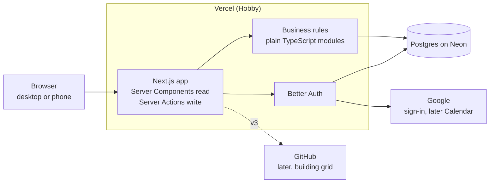

# Architecture

*Last updated: 2026-11-18*

**Status: planned, not built.** There is no application code yet. This describes the shape the decided stack gives the app, so the first code has something to match. When v1 code lands, this file is rewritten to describe what actually exists, file by file.

## The pieces

- **One Next.js app** ([0004](./adr/0004-one-nextjs-app-with-server-actions.md)). Pages are Server Components that read from the database and render on the server. Buttons and forms call Server Actions to write. There's no separate API.
- **Business rules in plain TypeScript** ([0004](./adr/0004-one-nextjs-app-with-server-actions.md)). Rules like "stale after 2 days" or "which day does this session belong to" live in modules that take the database (or a fake of it) as an argument. That makes them unit-testable and reusable if an API ever wraps them. For example, a function `isStale(task, today)` knows nothing about React or Next.js.
- **Postgres on Neon** ([0005](./adr/0005-postgres-on-neon-free-plan.md)), reached through **Drizzle** ([0006](./adr/0006-use-drizzle-as-the-orm.md)). The schema is TypeScript.
- **Better Auth** ([0008](./adr/0008-better-auth-with-google-and-encrypted-tokens.md)) handles Google sign-in and stores users, sessions, and linked accounts in the same Postgres. OAuth tokens are encrypted at rest.
- **Vercel Hobby** ([0007](./adr/0007-host-on-vercel-hobby.md)) builds and serves the app. A push to `main` deploys.

## Rules every piece follows

- **Every record has an owner** ([0011](./adr/0011-single-user-multi-user-ready.md)). Each table holding user data has a `userId`, and every query filters by it.
- **Every Server Action checks first.** It resolves the signed-in user, validates its input, and confirms every id it touches belongs to that user. A Server Action is a public endpoint that happens to look like a function call.
- **Days are in the user's time zone** ([0010](./adr/0010-store-each-sessions-local-date-and-utc-time.md)). A logged session stores `localDate` and a UTC `loggedAt`; the grid reads `localDate`.
- **Settings are data.** Activity types and families are rows, not constants ([0014](./adr/0014-movement-grid-families-and-activity-types.md)).

## Data, roughly

The v1 build plan settles the real schema. The entities the ADRs imply so far:

| Entity | Holds | Notes |
| --- | --- | --- |
| User, Session, Account | Who's signed in, and linked Google (later GitHub) accounts | Owned by Better Auth. Tokens encrypted |
| User settings | Time zone | Per user |
| Task | Title, list (backlog or current), position, `createdAt`, `enteredCurrentListAt`, optional due date, done | Two clocks, [0021](./adr/0021-two-clocks-and-optional-due-dates.md) |
| Family | Name, color | Five plus rest, [0014](./adr/0014-movement-grid-families-and-activity-types.md) |
| Activity type | Name, family | Per user, data not code |
| Logged session | Activity type, `localDate`, `loggedAt`, optional note | What fills a square |
