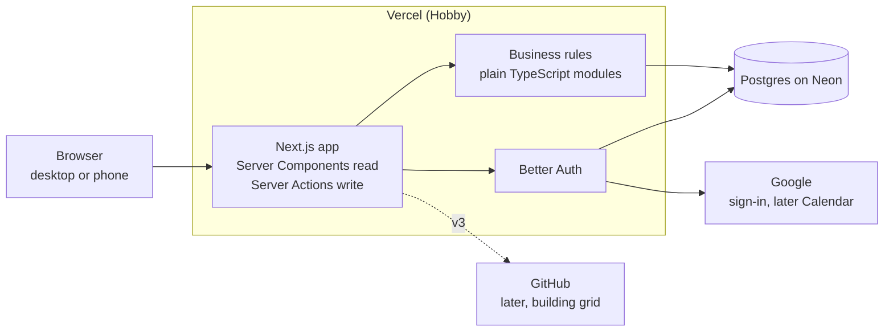

# Architecture

*Last updated: 2026-11-18*

**Status: mostly planned.** The app is scaffolded (plan step 3) and has one page; [What exists now](#what-exists-now) lists it. Everything else here describes the shape the decided stack gives the app, so the code has something to match. When v1 is done, this file is rewritten to describe what actually exists, file by file (plan step 17).

## The pieces

- **One Next.js app** ([0004](./adr/0004-one-nextjs-app-with-server-actions.md)). Pages are Server Components that read from the database and render on the server. Buttons and forms call Server Actions to write. There's no separate API.
- **Business rules in plain TypeScript** ([0004](./adr/0004-one-nextjs-app-with-server-actions.md)). Rules like "stale after 2 days" or "which day does this session belong to" live in modules that take the database (or a fake of it) as an argument. That makes them unit-testable and reusable if an API ever wraps them. For example, a function `isStale(task, today)` knows nothing about React or Next.js.
- **Postgres on Neon** ([0005](./adr/0005-postgres-on-neon-free-plan.md)), reached through **Drizzle** ([0006](./adr/0006-use-drizzle-as-the-orm.md)). The schema is TypeScript.
- **Better Auth** ([0008](./adr/0008-better-auth-with-google-and-encrypted-tokens.md)) handles Google sign-in and stores users, sessions, and linked accounts in the same Postgres. OAuth tokens are encrypted at rest.
- **Vercel Hobby** ([0007](./adr/0007-host-on-vercel-hobby.md)) builds and serves the app. A push to `main` deploys.

## Rules every piece follows

- **Every record has an owner** ([0011](./adr/0011-single-user-multi-user-ready.md)). Each table holding user data has a `userId`, and every query filters by it.
- **Every Server Action checks first.** It resolves the signed-in user, validates its input, and confirms every id it touches belongs to that user. A Server Action is a public endpoint that happens to look like a function call.
- **Days are in the user's time zone** ([0010](./adr/0010-store-each-sessions-local-date-and-utc-time.md)). A logged session stores `localDate` and a UTC `loggedAt`; the grid reads `localDate`.
- **Settings are data.** Activity types and families are rows, not constants ([0014](./adr/0014-movement-grid-families-and-activity-types.md)).

## Data, as planned

The schema the approved [v1 build plan](./V1-BUILD-PLAN.md#the-data-model) settles. Every table holding user data has `userId`, and every foreign key to another user-owned row includes `userId` too, so the database itself refuses a row that points at someone else's data ([0031](./adr/0031-one-server-action-helper-zod-and-composite-foreign-keys.md)). Moments are `timestamptz` (a UTC instant); "which day" fields are `date`, computed in the user's time zone ([0010](./adr/0010-store-each-sessions-local-date-and-utc-time.md)).

| Table | Holds | Notes |
| --- | --- | --- |
| `user`, `session`, `account`, `verification` | Who's signed in, and linked Google (later GitHub) accounts | Generated by Better Auth. OAuth tokens encrypted ([0008](./adr/0008-better-auth-with-google-and-encrypted-tokens.md)); session tokens stored as-is behind signed cookies ([0040](./adr/0040-accept-better-auths-plain-session-tokens-behind-signed-cookies.md)) |
| `user_settings` | `timeZone` | One row per user. Saved from the browser on first sign-in ([0039](./adr/0039-small-v1-product-calls.md)) |
| `family` | `key`, `name`, `colorKey`, `position` | Six per user (five plus rest), copied at sign-up ([0014](./adr/0014-movement-grid-families-and-activity-types.md), [0039](./adr/0039-small-v1-product-calls.md)) |
| `activity_type` | `name`, `familyId`, `archivedAt` | Per user, data not code |
| `logged_session` | `activityTypeId`, `localDate`, `loggedAt`, optional `note` | What fills a square. Not called `session`, which is Better Auth's sign-in table |
| `task` | `title`, `list`, `position`, `createdAt`, `enteredCurrentListAt`, `dueDate`, `completedAt`, `staleKeptOn`, `oldKeptUntil` | Two clocks ([0021](./adr/0021-two-clocks-and-optional-due-dates.md)); the two "kept" dates ([0036](./adr/0036-keep-quiets-a-stale-task-until-tomorrow.md), [0037](./adr/0037-keep-moves-a-task-out-of-getting-old-for-7-days.md)) |

## How the planned pieces connect

- **Local development** runs against Postgres in Docker, never production ([0028](./adr/0028-run-postgres-in-docker-for-local-development.md)). The app talks to Postgres through the `pg` driver in both places ([0029](./adr/0029-use-pg-over-tcp-in-development-and-production.md)).
- **Migrations** are SQL files generated by Drizzle Kit and applied by the production build on Vercel ([0030](./adr/0030-generate-sql-migrations-and-run-them-in-the-production-build.md)).
- **Writes** go through one Server Action helper that resolves the user and validates input with Zod ([0031](./adr/0031-one-server-action-helper-zod-and-composite-foreign-keys.md)).
- **Sign-in** is limited to the emails in `ALLOWED_EMAILS` ([0033](./adr/0033-allowlist-who-can-sign-in.md)).

## What exists now

As of plan step 3: a Next.js app with one page and no data.

| File | What it does |
| --- | --- |
| `src/app/layout.tsx` | The **root layout**: the HTML wrapper every page renders inside. Sets the page title, loads the Geist font, and imports the global styles |
| `src/app/page.tsx` | The page at `/`. A heading that says "Home Base" |
| `src/app/globals.css` | Loads Tailwind and defines the color tokens (background and foreground, light and dark). The family and task colors join them in plan step 10 |
| `next.config.ts` | Next.js settings: Cache Components on, and Tailwind's CSS loader |

The tooling around it (TypeScript, ESLint, Prettier, Vitest, the Node version) is explained in [`DEVELOPMENT.md`](./DEVELOPMENT.md#commands).

### Cache Components, and why it matters for a per-user app

`next.config.ts` turns on `cacheComponents`, which `create-next-app` in Next.js 16.4 enables by default, and which the next major version of Next.js turns on for every app. It changes what Next.js does with data by default:

- **Every read is fresh unless it opts into caching.** A Server Component that queries the database runs on every request. To cache something, a function says so with the `"use cache"` directive. For example, a page listing this user's tasks needs nothing special to stay current; a page showing the same public text to everyone could add `"use cache"` and be served from the cache.
- **Static shell, dynamic holes.** Next.js prerenders whatever doesn't depend on the request (the page frame, headings) into HTML at build time, and streams the parts that do (anything reading cookies, like "who is signed in," or the database) when the request arrives. Those parts sit inside a React `<Suspense>` boundary, which shows a fallback until they're ready. This is called **Partial Prerendering**.

For Home Base this default is the safe one. Almost everything on the screen belongs to one user, so it should never be cached and shown to someone else. Older versions of Next.js leaned the other way and cached more by default, so the mistake to watch for was caching something personal by accident.

Right now `/` has no data, so the build prerenders it entirely (`○ (Static)` in the build output).
